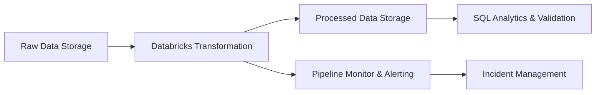

# Architecture Overview

## Data Pipeline Architecture

### Components
- **Data Ingestion (`data/raw/`)**: Source landing zone for raw incoming datasets.
- **Data Transformation (`databricks/transformation.py`)**: Spark / Databricks transformation notebooks and scripts.
- **Data Processing (`data/processed/`)**: Refined and curated data outputs.
- **Validation & Analytics (`sql/`)**: SQL data quality checks and analytical queries.
- **Pipeline Monitoring (`monitoring/pipeline_monitor.py`)**: Pipeline health checks, metrics, and alerts.
- **Incidents (`incidents/`)**: Post-mortems, alerts, and incident tracking records.
